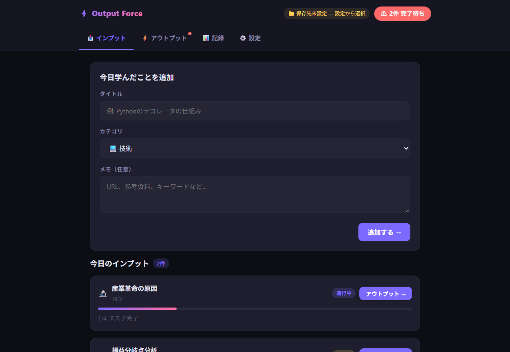

<div align="center">

# ⚡ Output Force

**学んだら、書く。インプットで終わらせない「アウトプット強制」ツール。**

[](https://www.python.org/)
[](https://flask.palletsprojects.com/)
[](#)
[](LICENSE)

</div>

学習した内容を **4つのタスク** でアウトプットし、**Obsidian 向けの Markdown** としてローカルに保存する、依存の少ないセルフホスト Web アプリです。

<!-- ここにスクリーンショットを追加: docs/screenshot.png -->
<!-- <p align="center"></p> -->

## ✨ Features

| タスク | 狙い |
| --- | --- |
| 🧠 フリーリコール | 見返さずに思い出せるだけ書き出す |
| 📝 3文要約 | 本質だけを3文に圧縮する |
| 🔧 実用例 | 実生活・仕事での使い方に落とす |
| 🗣️ 初心者への説明 | 平易な言葉で説明して理解の穴を見つける |

- 📂 カテゴリ(技術 / ビジネス / サイエンス / 語学 / その他)とステータス(待機中 / 進行中 / 完了)管理
- 📝 frontmatter 付き Markdown で保存 — Obsidian の Vault にそのまま置ける
- 📱 HTTPS(自己署名証明書を自動生成)で LAN 内のスマホからも利用可能
- 🔔 PWA / Service Worker による通知

## 🚀 Quick Start

```bash
git clone https://github.com/aauua16/output-force.git
cd output-force
python -m venv .venv
.venv/Scripts/pip install -r requirements.txt   # macOS/Linux: .venv/bin/pip
.venv/Scripts/python server.py
```

Windows なら [`scripts/start.bat`](scripts/start.bat) をダブルクリックするだけ(初回は仮想環境も自動作成)。

- PC: <http://localhost:3000>
- スマホ等: `https://<PCのIP>:3443`(初回は証明書の警告を許可)
  - 繋がらない場合は管理者権限で [`scripts/open-firewall.bat`](scripts/open-firewall.bat) を実行

## ⚙️ Configuration

| 環境変数 | 既定値 | 説明 |
| --- | --- | --- |
| `OUTPUT_FORCE_DATA_DIR` | `./data` | Markdown ノートの保存先。Obsidian Vault 内のフォルダを指定すると便利 |

`.env.example` を `.env` にコピーして値を書くか、Windows なら `config.local.bat`(どちらもGit管理外)に `set OUTPUT_FORCE_DATA_DIR=...` と書けば読み込まれます。

## 🗂️ Project Structure

```
output-force/
├── server.py          # Flask サーバー(API + 静的配信 + HTTPS)
├── static/            # フロントエンド(index.html, sw.js)
├── scripts/           # Windows 用ランチャー
├── requirements.txt
└── LICENSE
```

## 🔐 Security notes

- 静的配信は `static/` のみ。`cert/`(秘密鍵)や `data/`(個人ノート)は配信・コミットされません。
- 認証はありません。**信頼できる LAN 内でのみ**利用してください。

## 📄 License

[MIT](LICENSE)
